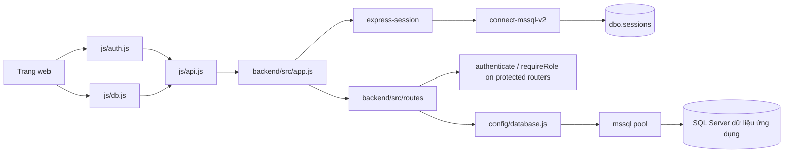

# Hướng dẫn Backend và JavaScript của JobViệt

## Phạm vi

Tài liệu này tập trung vào mã backend trong `backend/` và JavaScript phía trình duyệt trong `js/`. Trang HTML, CSS, icon và các tài liệu khác được chủ ý lược bỏ khỏi danh sách. Một số trang HTML có JavaScript trực tiếp trong thẻ `<script>`; phần inline đó không thuộc phạm vi phiên bản này. Các file được liệt kê là những file backend/JS đang được Git theo dõi; không bao gồm `node_modules/`, `.git/` hay file `.env` chứa thông tin bí mật.

Mỗi mục nêu chức năng và nội dung chính của file. Đây là bản đồ source code, không phải bản sao đầy đủ từng dòng mã.

## Kiến trúc trong một request

1. Trang giao diện gọi các hàm của `js/db.js` hoặc `js/auth.js`.
2. Những module này dùng `js/api.js` để gửi HTTP request tới `/api`, kèm cookie session.
3. `backend/src/app.js` nhận request và chuyển tới route tương ứng trong `backend/src/routes/`.
4. Middleware xác thực session và vai trò trước khi route đọc/ghi dữ liệu bằng pool SQL Server.
5. Route trả JSON; frontend cập nhật giao diện hoặc hiển thị lỗi.

## Công nghệ và package: nằm ở đâu, được dùng để làm gì

Các package được khai báo trong `backend/package.json`; phiên bản npm chính xác được khóa trong `backend/package-lock.json`. Sau `npm install`, code thư viện được cài dưới `backend/node_modules/<tên-package>`; thường không chỉnh tay các file đó. Source của project **import/cấu hình** package tại các file được nêu ở bảng. Chạy lệnh npm từ thư mục `backend/`.

| Công nghệ/package | Khai báo/cấu hình | File sử dụng | Vai trò |
|---|---|---|---|
| Node.js + CommonJS | `backend/package.json`; `require()`/`module.exports` | `backend/src/` | Runtime chạy backend và định dạng module backend. |
| Express | Dependency `express`; app tại `backend/src/app.js` | `app.js`, `backend/src/routes/*.routes.js` | HTTP server, middleware, router, API JSON và serve frontend. |
| `mssql` | Dependency `mssql`; cấu hình ở `backend/src/config/database.js` | Hầu hết route backend dùng SQL | Driver SQL Server cho Node.js. `ConnectionPool` được chia sẻ; các route dùng `pool.request()`, `.input()` và `.query()` để chạy SQL có bind parameters. |
| `connect-mssql-v2` | Khai báo trong `backend/package.json`; cài ở `backend/node_modules/connect-mssql-v2`; import tại `backend/src/config/session.js` | `session.js`, vòng đời ở `backend/src/server.js` | Adapter lưu session của `express-session` vào SQL Server, bảng `dbo.sessions`. Đây là session store, không phải pool truy vấn nghiệp vụ. |
| `express-session` | Dependency; cấu hình trong `backend/src/config/session.js` | Gắn bởi `backend/src/app.js` | Quản lý session và cookie `jv.sid`; cookie chứa mã phiên, dữ liệu phiên được lưu ở store. |
| `argon2` | Khai báo trong `backend/package.json`; cài ở `backend/node_modules/argon2`; import tại `backend/src/routes/auth.routes.js` và `backend/src/routes/me.routes.js` | Hai route auth/me | Hash mật khẩu khi đăng ký/đổi mật khẩu và xác minh hash khi đăng nhập/đổi mật khẩu, dùng chế độ Argon2id. |
| `dotenv` | Dependency; nạp tại `backend/src/server.js` | `server.js` và module cấu hình | Đọc `.env` vào `process.env`; `backend/.env.example` liệt kê tên biến mẫu. `.env` thật không được commit. |
| `nodemon` | Dev dependency; script `dev` trong `backend/package.json` | Chạy qua `npm run dev` | Tự khởi động lại server khi sửa code lúc phát triển; không phải thành phần phục vụ production. |
| `nodemailer` | Dependency runtime trong `backend/package.json`; transporter cấu hình tại `backend/src/config/mail.js` | `config/mail.js`, `services/emailService.js`, `src/test-mail.js` | Kết nối SMTP để gửi mã OTP xác minh email; không cung cấp hộp thư hoặc lưu email. |
| Node built-ins | `node:path`, `node:assert`, `node:fs` | `app.js`, `backend/scripts/test-frontend-host.js` | Thư viện có sẵn trong Node, dùng xử lý đường dẫn/file và assertion trong test; không phải package npm. |

Ví dụ, để tự tìm hai thư viện bạn hỏi trong PowerShell:

```powershell
cd D:\DH52300430\backend
npm ls connect-mssql-v2 argon2
rg -n "connect-mssql-v2|argon2" package.json src
```

Lệnh thứ nhất xem package đã được cài trong `backend/node_modules/` chưa; lệnh thứ hai chỉ ra file source import/cấu hình thư viện. `package.json` là danh sách khai báo, `package-lock.json` là phiên bản đã khóa, còn phần code thư viện nằm trong `node_modules`.

### Hai phần kết nối SQL Server

- `backend/src/config/database.js` dùng `mssql` tạo pool dùng chung cho dữ liệu ứng dụng như users, jobs, applications, messages.
- `backend/src/config/session.js` dùng `connect-mssql-v2` tạo store để đọc/ghi session vào `dbo.sessions`.
- Cả hai lấy thông số từ `buildConfig()` trong `database.js`, nhưng giữ hai nhiệm vụ riêng. `server.js` mở database pool, khởi tạo session store, sau đó mới nhận request. Khi dừng, nó đóng session store và pool.

### Sơ đồ kết nối module



### Cách module được nạp

- Backend dùng CommonJS: `require('./...')` nạp file và `module.exports` trả app/router/helper.
- `js/api.js`, `js/auth.js`, `js/db.js` dùng browser ES modules (`import`/`export`). `auth.js`/`db.js` import `apiRequest` từ `api.js`.
- Một số script giao diện dùng browser globals để gọi chéo: `auth.js` đặt `window.Auth`, `db.js` đặt `window.DB`, `app.js` đặt `window.App`/`window.BadgeNotifier`. `navbar.js` bọc IIFE để helper nội bộ không lộ ra global; `notifications.js` khai báo `Toast` cho script trang.
- Các file HTML bị lược khỏi danh sách theo phạm vi, nhưng HTML là nơi nạp những JS module/script này; thứ tự nạp phải bảo đảm `api.js` có trước các module phụ thuộc và các global sẵn sàng trước khi trang gọi.

## Các API được nối trong `backend/src/app.js`

`app.js` gắn mỗi router vào prefix gốc bên dưới. Ví dụ router có `POST /register` trong `auth.routes.js` tạo URL đầy đủ `POST /api/auth/register`. Endpoint trong phần liệt kê từng file route là đường dẫn tương đối sau prefix.

| Prefix API | Router | Chức năng chính | Phân quyền/kiểm tra chính |
|---|---|---|---|
| `/api/health` | `routes/health.routes.js` | Kiểm tra tiến trình API và SQL Server. | `GET /` không cần session; `GET /db` chạy truy vấn kiểm tra database. |
| `/api/auth` | `routes/auth.routes.js`, `routes/auth-email.routes.js` | Gửi/xác minh OTP đăng ký, đăng ký, đăng nhập, đăng xuất. | Đăng ký cần token xác minh email còn hạn và chưa sử dụng; login/logout dùng session. |
| `/api/me` | `routes/me.routes.js` | Đọc/cập nhật user hiện tại, hồ sơ ứng viên, đổi password. | Gọi `authenticate`; danh tính lấy từ session đã kiểm tra trong database. |
| `/api/jobs` | `routes/jobs.routes.js` | Danh sách và chi tiết tin public; ghi lượt xem tin. | Đọc job public; giới hạn tần suất ghi lượt xem. |
| `/api/employer/jobs` | `routes/employer-jobs.routes.js` | Nhà tuyển dụng quản lý tin của chính họ. | Router yêu cầu session hợp lệ và role `employer`; kiểm tra quyền sở hữu job. |
| `/api/applications` | `routes/applications.routes.js` | Ứng viên ứng tuyển; hai bên xem đơn; nhà tuyển dụng cập nhật trạng thái. | Router yêu cầu session và role candidate/employer/admin; kiểm tra quyền trên từng đơn/job. |
| `/api/interviews` | `routes/interviews.routes.js` | Tạo/xem lịch phỏng vấn gắn với application. | Session và quyền của ứng viên/nhà tuyển dụng sở hữu application. |
| `/api/stats` | `routes/stats.routes.js` | Thống kê tổng hợp số job active, công ty, ứng viên và application. | Endpoint hiện truy vấn tổng hợp public; không gắn `authenticate`. |
| `/api/users` | `routes/users.routes.js` | Tra cứu hồ sơ ứng viên. | Session; danh sách ứng viên dành cho employer/admin; endpoint ID giới hạn dữ liệu trả về. |
| `/api/employer/company` | `routes/employer-company.routes.js` | Lấy/tạo/cập nhật thông tin công ty. | Session và role employer; công ty gắn với employer đang đăng nhập. |
| `/api/saved-jobs` | `routes/saved-jobs.routes.js` | Liệt kê, kiểm tra, thêm/bỏ lưu việc làm. | Session và role candidate; thao tác theo candidate trong session. |
| `/api/messages` | `routes/messages.routes.js` | Hội thoại, tải trang tin nhắn, gửi tin, đánh dấu đã đọc. | Session và role candidate/employer; chỉ thành viên hội thoại mới được đọc/gửi. |
| `/api/invites` | `routes/invites.routes.js` | Nhà tuyển dụng gửi lời mời; ứng viên phản hồi. | Gửi bởi employer, xem/nhận/từ chối bởi candidate; có rate limit khi gửi. |
| `/api/profile-views` | `routes/profile-views.routes.js` | Nhà tuyển dụng ghi lượt xem; ứng viên xem lịch sử. | Ghi bởi employer, đọc bởi candidate; danh tính lấy từ session. |

### Nối từ JavaScript tới route và dữ liệu

| Phía trình duyệt | Route backend | Dữ liệu SQL chính | Vai trò luồng |
|---|---|---|---|
| `Auth.register/login/logout/requireAuth` trong `js/auth.js` | `auth.routes.js`, `me.routes.js` | `users`, `candidate_profiles`, `companies`, session store `sessions` | Giao diện gửi thông tin; backend xác minh/ghi tài khoản và tạo hoặc hủy cookie session. |
| `DB.getUsers/getUserById/updateUser` | `users.routes.js`, `me.routes.js` | `users`, `candidate_profiles`, `jobs`, `applications` | Lấy hồ sơ theo quyền hoặc cập nhật hồ sơ user hiện tại. |
| `DB.getJobs/getJobById/incrementJobViews` | `jobs.routes.js` | `jobs`, `companies` | Duyệt tin public, xem chi tiết, ghi nhận lượt xem. |
| `DB.getJobsByEmployer/createJob/updateJob/deleteJob` | `employer-jobs.routes.js` | `jobs`, `companies` | Nhà tuyển dụng quản lý tin của mình. |
| `DB.getApplications/createApplication/updateApplication/deleteApplication` | `applications.routes.js` | `applications`, `jobs`, `users`, `companies` | Ứng tuyển và xử lý hồ sơ; backend ràng buộc candidate/job/recruiter. |
| `DB.getInterviews/scheduleInterview` | `interviews.routes.js` | `interviews`, `applications`, `jobs`, `companies` | Lên lịch phỏng vấn cho đơn mà nhà tuyển dụng sở hữu. |
| `DB.getSavedJobs/isJobSaved/toggleSaveJob` | `saved-jobs.routes.js` | `saved_jobs`, `jobs` | Lưu/bỏ lưu tin theo ứng viên đăng nhập. |
| `DB.getCompanyByEmployer/createCompany/updateCompany` | `employer-company.routes.js` | `companies` | Quản lý thông tin công ty thuộc nhà tuyển dụng hiện tại. |
| `DB.getMessages/sendMessage/getConversations/markAsRead` | `messages.routes.js` | `messages`, `users` | Tải hội thoại theo từng trang/cursor, gửi tin và cập nhật đã đọc. |
| `DB.sendInvite/getInvitesByCandidate/updateInviteStatus` | `invites.routes.js` | `invites`, `jobs`, `users`, `companies` | Nhà tuyển dụng mời ứng viên; ứng viên phản hồi. |
| `DB.recordProfileView/getProfileViewsByCandidate` | `profile-views.routes.js` | `profile_views`, `users`, `companies` | Ghi lượt xem hồ sơ và trả lịch sử cho ứng viên. |
| `DB.getPublicStats` và hàm thống kê dashboard | `stats.routes.js` | `jobs`, `applications`, `users` | Tổng hợp số liệu public cho giao diện. |

## Middleware và cách một request được kiểm tra

- `app.js` xử lý CORS cho các origin frontend đã cho phép, static files và JSON body; health route được gắn trước session để kiểm tra sống không cần SQL session store.
- `createSessionMiddleware()` trong `config/session.js` đặt `req.session` cho các request API còn lại.
- Các router riêng tự gắn `authenticate` và `requireRole` ở cấp router hoặc route. `authenticate.js` đọc `req.session.userId`, tải trạng thái user hiện tại từ `dbo.users`, đặt `req.user`; tài khoản không tồn tại/bị khóa thì hủy session.
- `requireRole()` kiểm tra `req.user.role`, trả 401 nếu chưa xác thực và 403 nếu sai quyền.
- `asyncHandler.js` chuyển lỗi từ async handler đến `errorHandler.js`. `notFound`/`errorHandler` cuối chuỗi Express trả lỗi JSON.
- `rateLimit.js` là bộ giới hạn tự viết trong project, không phải package rate-limit bên ngoài. Các route auth, application, invite, job view và message dùng nó với ngưỡng phù hợp từng thao tác.

## Cách frontend gọi backend

1. Các trang nạp `js/api.js`, `js/db.js`, `js/auth.js` và/hoặc `js/app.js`.
2. Thao tác đăng nhập dùng `Auth.login()` → `apiRequest('/auth/login')` → `POST /api/auth/login`.
3. Thao tác dữ liệu dùng `DB.*()` → `apiRequest()` → prefix API tương ứng ở bảng trên.
4. `api.js` truyền cookie session bằng `credentials: 'include'`; browser tự gửi cookie ở những request cùng site.
5. Backend trả JSON; `apiRequest()` phân tích body và ném lỗi nếu HTTP status không thành công; trang hoặc `App` quyết định hiển thị dữ liệu/thông báo.
6. Frontend không dùng SQL driver và không giữ password hash. `js/db.js` chỉ là HTTP wrapper, không phải database client.

## backend

### `backend/.env.example`

Mẫu biến runtime gồm HTTP/session/CORS, kết nối SQL Server và SMTP. Các biến mail là `SMTP_HOST`, `SMTP_PORT`, `SMTP_SECURE`, `SMTP_USER`, `SMTP_PASS`; `OTP_SECRET` phải có ít nhất 32 byte entropy để HMAC mã OTP. File chỉ chứa placeholder; thông tin thật điền vào `.env` cục bộ và không commit.

### `backend/package-lock.json`

Khóa chính xác phiên bản dependency để npm cài đặt lặp lại ổn định.

### `backend/package.json`

Manifest npm: entry point `src/server.js`; scripts `start`, `dev`, `test:frontend`, `test:mail`; dependency runtime gồm `nodemailer` cho SMTP. Đây là nơi xem package được khai báo; phiên bản khóa nằm trong `package-lock.json`.

## backend/scripts

### `backend/scripts/test-frontend-host.js`

Bài kiểm tra tích hợp nhẹ dùng Node built-ins (`assert`, `fs`, `path`) và `fetch`; khởi chạy Express app ở cổng tạm để kiểm tra trang/assets, health API, JSON 404 và từ chối file nội bộ/path traversal. Không kết nối SQL Server nên không kiểm thử truy vấn nghiệp vụ. Chạy từ `backend/` bằng `npm run test:frontend`.

## backend/sql

### `backend/sql/001_create_sessions.sql`

Tạo bảng dbo.sessions và index hết hạn để express-session lưu phiên đăng nhập. Đối tượng bảng được nhắc tới: dbo.sessions.

### `backend/sql/002_create_applications.sql`

Tạo dbo.applications cùng khóa/quan hệ và index phục vụ tra cứu đơn ứng tuyển. Đối tượng bảng được nhắc tới: dbo.applications, dbo.jobs, dbo.users.

### `backend/sql/003_add_application_cv_text.sql`

Bổ sung cột cv_text cho nội dung CV chụp tại thời điểm ứng tuyển. Đối tượng bảng được nhắc tới: dbo.applications.

### `backend/sql/004_create_interviews.sql`

Tạo bảng dbo.interviews cho lịch phỏng vấn liên kết với đơn ứng tuyển. Đối tượng bảng được nhắc tới: dbo.interviews, dbo.applications.

### `backend/sql/005_upgrade_interviews_columns.sql`

Nâng cấp bảng interviews với ngày/giờ, thời gian, loại, ghi chú và timestamp cần cho API. Đối tượng bảng được nhắc tới: dbo.interviews.

### `backend/sql/006_add_profile_fields.sql`

Thêm cờ hồ sơ cho users; tạo/bổ sung candidate_profiles và thêm trường hồ sơ công ty. Đối tượng bảng được nhắc tới: dbo.users, dbo.candidate_profiles, dbo.companies.

### `backend/sql/007_create_saved_jobs.sql`

Tạo dbo.saved_jobs để lưu quan hệ ứng viên–tin đã lưu và index liên quan. Đối tượng bảng được nhắc tới: dbo.saved_jobs, dbo.users, dbo.jobs.

### `backend/sql/008_create_messages.sql`

Tạo cấu trúc hội thoại/tin nhắn và các chỉ mục phục vụ truy vấn. Đối tượng bảng được nhắc tới: dbo.messages, dbo.users.

### `backend/sql/009_limit_message_content.sql`

Điều chỉnh giới hạn/kích thước cột nội dung tin nhắn tương thích SQL Server. Đối tượng bảng được nhắc tới: dbo.messages.

### `backend/sql/010_create_invites.sql`

Tạo bảng lời mời nhà tuyển dụng gửi ứng viên và index cần thiết. Đối tượng bảng được nhắc tới: dbo.invites, dbo.users, dbo.jobs.

### `backend/sql/011_create_profile_views.sql`

Tạo bảng ghi nhận lượt xem hồ sơ giữa nhà tuyển dụng và ứng viên. Đối tượng bảng được nhắc tới: dbo.profile_views, dbo.users.

Các file SQL ở đây là migrations bổ sung, không phải schema khởi tạo toàn bộ ứng dụng. Code route cũng tham chiếu `dbo.email_verifications`, nhưng hiện chưa có migration tạo/nâng cấp bảng này trong `backend/sql`; API xác minh email chỉ chạy khi bảng đã được tạo đúng schema. Các bảng lõi `dbo.users`, `dbo.jobs`, `dbo.companies` cũng cần có trước. `server.js` không tự chạy migrations khi khởi động; việc thay đổi schema được thực hiện riêng trong SQL Server Management Studio.

## backend/src

### `backend/src/app.js`

Composition root của Express: import tất cả router/middleware; tạo `app`; xử lý preflight/CORS; chỉ serve các folder frontend được phép và danh sách trang gốc; parse JSON tối đa 1 MB; gắn health route rồi session; gắn từng API prefix; cuối cùng gắn JSON 404/error handler. File này nối module lại với nhau, còn truy vấn nghiệp vụ nằm trong route files.

### `backend/src/server.js`

Entry point được `npm start`/`npm run dev` gọi. Nạp `.env` qua `dotenv`, gọi `connectDatabase()` trước, gọi `app.locals.connectSessionStore()` tiếp theo, chỉ `app.listen()` khi cả hai thành công. Với SIGINT/SIGTERM, nó dừng nhận request rồi gọi các hàm đóng session store và pool. Nếu SQL không sẵn sàng, server không mở cổng.

### `backend/src/test-mail.js`

Script `npm run test:mail` nạp `.env`, kiểm tra `OTP_SECRET`, tạo Nodemailer transporter và gọi `transporter.verify()` để kiểm tra khả năng xác thực/kết nối SMTP. Script không gửi email thử.

## backend/src/config

### `backend/src/config/database.js`

Module cấu hình và chia sẻ SQL Server client. Import `mssql`; `requireEnv()` báo biến bắt buộc còn thiếu; `buildConfig()` dựng cấu hình từ `DB_*`, chọn named instance hoặc port và thiết lập pool/timeouts/TLS. `connectDatabase()` mở một `ConnectionPool` duy nhất; `getPool()` cấp pool cho routes; `checkDatabase()` chạy `SELECT 1`; `closeDatabase()` đóng pool. Xuất `sql` để route dùng kiểu SQL như `sql.BigInt`/`sql.NVarChar` và transaction/request.

### `backend/src/config/session.js`

Adapter phiên đăng nhập. Import `express-session`, `connect-mssql-v2` và `buildConfig()` từ database config. `createSessionMiddleware()` kiểm tra `SESSION_SECRET`, tạo MSSQLStore trỏ tới `[dbo].[sessions]` với TTL 7 ngày, đặt cookie HttpOnly/SameSite và bật Secure khi production. `connectSessionStore()` khởi tạo/kết nối store; `closeSessionStore()` đóng kết nối store. `app.js` gọi factory để gắn middleware; `server.js` quản lý lifecycle; `auth.routes.js` lấy tên cookie và lưu/hủy session qua helper.

### `backend/src/config/mail.js`

Import `nodemailer`, đọc và kiểm tra `SMTP_HOST`, `SMTP_PORT`, `SMTP_USER`, `SMTP_PASS`, `SMTP_SECURE`, rồi tạo transporter SMTP. Module không gửi email; `emailService.js` dùng transporter này. `test-mail.js` gọi `verify()` để kiểm tra cấu hình/kết nối.

## backend/src/middleware

### `backend/src/middleware/authenticate.js`

Middleware async chạy trong các router cần đăng nhập. Đọc `req.session.userId`, query `dbo.users` qua pool mssql, kiểm tra tài khoản còn active, gắn `req.user` lấy từ database. Nếu session thiếu/hết hiệu lực trả 401; user bị khóa thì xóa session trước khi từ chối. Dùng `asyncHandler` để lỗi SQL đi tới error handler; gọi `destroySession()` khi cần thu hồi phiên.

### `backend/src/middleware/errorHandler.js`

Export hai middleware được gắn cuối `app.js`: `notFound` tạo lỗi JSON cho URL không tìm thấy; `errorHandler` chuyển lỗi HTTP/SQL/validation thành status và JSON an toàn, log chi tiết phía server nhưng không gửi stack trace nội bộ về trình duyệt.

### `backend/src/middleware/rateLimit.js`

Bộ đếm cửa sổ thời gian trong bộ nhớ tiến trình. Nhận cấu hình `windowMs`, `max`, hàm tạo key và thông báo; trả 429 khi vượt ngưỡng, tự dọn bucket cũ. Route auth dùng IP; các thao tác ứng tuyển/tin nhắn/lời mời có thể dùng user ID từ session. Bộ đếm này không chia sẻ giữa nhiều process/máy chủ.

### `backend/src/middleware/requireRole.js`

Factory tạo middleware nhận một hoặc nhiều role, ví dụ `requireRole('employer')`. Phải chạy sau `authenticate`, vì role được đọc từ `req.user`; trả 401 nếu danh tính không có và 403 nếu role không nằm trong danh sách. Router thường gắn nó bằng `router.use()` để bảo vệ toàn bộ endpoint.

## backend/src/routes

### `backend/src/routes/applications.routes.js`

API ứng tuyển; router dùng `authenticate` + `requireRole`, truy vấn `applications` nối với `jobs`, `users`, `companies`. Ứng viên tạo đơn và xem trạng thái của mình; employer xem đơn thuộc tin của mình và cập nhật trạng thái; kiểm tra ID/ownership trước khi đọc/ghi; giới hạn tần suất nộp đơn. Endpoints: `GET /`, `GET /check/:jobId`, `GET /job/:jobId`, `POST /`, `GET /:id`, `PATCH /:id`, `DELETE /:id`.

### `backend/src/routes/auth.routes.js`

Luồng xác thực chính, đồng thời gắn `auth-email.routes.js` dưới `/email`. Đăng ký yêu cầu `verificationToken`; trong transaction kiểm tra token còn hạn/chưa dùng, tạo user và candidate profile hoặc company, đánh dấu token đã dùng, sau commit tạo session. Password dùng Argon2id. Đăng nhập kiểm tra hash/trạng thái và regenerate/save session; logout hủy session và xóa cookie. Các endpoint của router: `POST /register`, `POST /login`, `POST /logout`; đường dẫn đầy đủ có prefix `/api/auth`.

### `backend/src/routes/auth-email.routes.js`

Hai endpoint public phục vụ bước xác minh trước đăng ký. `POST /send-code` kiểm tra email chưa đăng ký; nếu email đã có tài khoản, endpoint vẫn trả phản hồi chung nhưng không gửi mã. Với email có thể đăng ký, route tạo hoặc thay challenge gần nhất trong `dbo.email_verifications`, rồi gửi OTP qua email. Mã OTP có 6 chữ số, hết hạn sau 5 phút, chờ gửi lại 60 giây, tối đa 5 lần nhập sai; route giới hạn số request theo IP. `POST /verify-code` xác minh OTP trong transaction, tạo token ngẫu nhiên dùng một lần có hạn 10 phút và chỉ lưu SHA-256 hash của token. OTP được lưu dạng HMAC-SHA256, không lưu mã gốc. Bảng được dùng là `dbo.email_verifications`.

### `backend/src/services/emailService.js`

Tạo transporter khi gửi email lần đầu và dùng lại trong process. `sendOTPEmail(to, otp)` gửi email HTML JobViệt qua SMTP, nêu mã và thời hạn 5 phút. Đây là nơi định dạng nội dung email; cấu hình SMTP nằm ở `config/mail.js`.

### `backend/src/routes/employer-company.routes.js`

Đọc/tạo/cập nhật bản ghi `companies` gắn với `req.user.id`; router bảo vệ session và role employer để người dùng không sửa công ty của tài khoản khác. Endpoints: `GET /`, `POST /`, `PUT /`.

### `backend/src/routes/employer-jobs.routes.js`

API quản lý tin thuộc nhà tuyển dụng hiện tại. Có bộ mô tả field/giới hạn độ dài, validate form, bind tham số SQL và kiểm tra `recruiter_id` trước khi sửa/đóng. Dùng `jobs` nối `companies`. Endpoints: `GET /`, `GET /:id`, `POST /`, `PATCH /:id`, `PATCH /:id/close`.

### `backend/src/routes/health.routes.js`

API kiểm tra backend sống và kiểm tra kết nối database. Endpoint khai báo: GET /, GET /db.

### `backend/src/routes/interviews.routes.js`

API lịch phỏng vấn liên kết `interviews` → `applications` → `jobs`/`companies`. Xác minh ngày và giờ, quyền employer/candidate trên đơn và ngăn người dùng xem lịch không liên quan. Endpoints: `GET /`, `GET /application/:applicationId`, `POST /`.

### `backend/src/routes/invites.routes.js`

API lời mời giữa employer và candidate. Kiểm tra candidate active; nếu mời theo job, kiểm tra job thuộc employer đang gửi; chặn lời mời pending trùng; candidate chỉ đổi trạng thái lời mời của mình từ pending sang accepted/rejected. Ghi `dbo.invites`, nối `users`, `jobs`, `companies`; rate limit gửi. Endpoints: `GET /`, `POST /`, `PATCH /:id/status`.

### `backend/src/routes/jobs.routes.js`

API public đọc tin active/chưa hết hạn từ `jobs` nối `companies`. Endpoint view tăng `views` nguyên tử, không tính lượt của chính nhà tuyển dụng và dùng `OUTPUT INTO` tương thích trigger SQL Server. Có rate limit. Endpoints: `GET /`, `POST /:id/view`, `GET /:id`.

### `backend/src/routes/me.routes.js`

API của tài khoản hiện tại, bảo vệ bằng `authenticate`. `GET /` trả `req.user`; `PATCH /profile` validate và cập nhật `users` cùng `candidate_profiles` cho candidate, chỉ nhận field cho phép, từ chối bật 2FA vì chưa hỗ trợ; `POST /password` xác minh mật khẩu cũ qua `argon2`, băm mật khẩu mới rồi cập nhật `users.password_hash`. Endpoints: `GET /`, `PATCH /profile`, `POST /password`.

### `backend/src/routes/messages.routes.js`

API nhắn tin candidate–employer. Router xác thực role, chỉ trả nội dung giữa user hiện tại và contact hợp lệ, giới hạn số tin mỗi request, dùng cursor để tải tin cũ, đếm chưa đọc và ghi/đánh dấu đã đọc trong `dbo.messages`. Có rate limit gửi. Endpoints: `GET /conversations`, `GET /conversation/:contactId`, `POST /`, `PATCH /read/:contactId`.

### `backend/src/routes/profile-views.routes.js`

Ghi nhận employer xem profile candidate và trả lịch sử xem cho candidate. Không cho employer xem chính mình hoặc ghi user không phải candidate active; trong cùng ngày cập nhật bản ghi thay vì cộng trùng, nhờ bảng `profile_views` và các cột ngày/giờ xem. Endpoints: `GET /`, `POST /`.

### `backend/src/routes/saved-jobs.routes.js`

API lưu tin của ứng viên trong `saved_jobs`; mọi truy vấn lấy candidate ID từ session, không tin ID người dùng gửi từ trình duyệt. Kiểm tra ID và job trước khi toggle/xóa. Endpoints: `GET /`, `GET /check/:jobId`, `POST /:jobId/toggle`, `DELETE /:jobId`.

### `backend/src/routes/stats.routes.js`

API thống kê tổng hợp public: đếm job active/chưa hết hạn, công ty có job active, candidate active và applications. Trả JSON cho trang tổng quan; route hiện tại không gắn middleware xác thực. Endpoint: `GET /`.

### `backend/src/routes/users.routes.js`

Router xác thực session và role candidate/employer/admin. `GET /candidates` chỉ employer/admin xem candidate active đang bật tìm việc; `GET /:id` lọc field nhạy cảm như email/phone và chỉ cho xem theo quan hệ application, quyền admin hoặc chính chủ. Chuẩn hóa `skills` từ JSON/string thành array. Đọc `users`, `candidate_profiles`, `applications`, `jobs`. Endpoints: `GET /candidates`, `GET /:id`.

## backend/src/utils

### `backend/src/utils/asyncHandler.js`

Bọc hàm route async thành `(req, res, next) => Promise.resolve(handler(...)).catch(next)`. Các route dùng nó để lỗi từ await/SQL Server chảy tới `middleware/errorHandler.js`, thay vì tạo unhandled rejection.

### `backend/src/utils/sessionHelpers.js`

Chuyển callback API của `express-session` thành Promise cho ba thao tác `regenerateSession`, `saveSession`, `destroySession`. `auth.routes.js` dùng regenerate trước khi gắn userId để chống session fixation, save để đảm bảo session được ghi vào MSSQLStore trước response đăng nhập, destroy khi logout hoặc thu hồi phiên.

### `backend/src/utils/otp.js`

Tạo OTP sáu chữ số bằng `crypto.randomInt`, kiểm tra độ dài khóa `OTP_SECRET`, tạo HMAC-SHA256 gắn với email và so sánh hash theo thời gian an toàn. Được `auth-email.routes.js` gọi; không gửi email và không truy vấn database.

## js

### `js/api.js`

HTTP client tầng thấp nhất của frontend. Chọn API URL cùng origin mặc định, tương thích Live Server cổng 5500/5501, cho phép `window.JV_API_BASE_URL` ghi đè. `apiRequest()` dùng `fetch`, gửi cookie bằng `credentials: "include"`, gửi/đọc JSON và chuyển response lỗi thành exception có status. Module đưa hàm ra `window.JVApi` và export cho ES module; được `auth.js` và `db.js` import.

### `js/app.js`

Logic giao diện dùng chung, chủ yếu cho dashboard. `renderSidebar()` và `_get*Menu()` dựng menu theo role; `BadgeNotifier` đọc badge count và polling; `renderFeaturedJobs()` dựng job cards; `paginate()`/`renderPagination()`/`debounce()`/`timeAgo()`/`formatDate()` là tiện ích UI; `initFloatingChat()`/`openChat()`/`loadOlderChatMessages()`/`handleWidgetSend()` dựng và vận hành chat widget. Gọi `Auth` để lấy user và `DB` để đọc/gửi/cập nhật dữ liệu; trang dashboard gọi qua `window.App`. File escape nội dung chat trước khi render HTML và cập nhật đã đọc.

### `js/auth.js`

Định nghĩa `window.Auth`, API xác thực frontend. `sendEmailCode()` và `verifyEmailCode()` gọi hai endpoint email; `register()` gửi `verificationToken` cùng thông tin tài khoản. `login()`/`logout()` gọi API session; frontend lưu bản tóm tắt user trong `localStorage` để dựng giao diện. `requireAuth(roles)` kiểm tra role phía UI rồi gọi `/me`; quyền thật vẫn do backend kiểm tra.

### `auth.html` (phần luồng xác minh email)

Trang đăng nhập/đăng ký hiển thị nút gửi OTP, ô nhập mã và trạng thái xác minh. Các hàm inline `sendRegistrationCode()` và `verifyRegistrationCode()` gọi `window.Auth`; token trả về chỉ được giữ trong state JavaScript của trang để gửi cùng request đăng ký. Không lưu OTP/token trong `localStorage`.

### `js/db.js`

Lớp truy cập dữ liệu phía trình duyệt, xuất thành `window.DB`. Nhóm chính: `getUsers/getUserById/updateUser`; `getJobs/getJobById/createJob/updateJob/deleteJob/incrementJobViews`; `getApplications/createApplication/updateApplication/deleteApplication/hasApplied`; `getInterviews/scheduleInterview`; `getSavedJobs/toggleSaveJob`; `getCompanyByEmployer/updateCompany`; `changePassword`; `getMessages/sendMessage/getConversations/markAsRead`; `sendInvite/updateInviteStatus`; `recordProfileView/getProfileViewsByCandidate`. Các hàm subscriber ứng tuyển `onApplicationsByRecruiter/onApplicationsByCandidate` thực tế polling API mỗi 5 giây, không dùng WebSocket/realtime database. Mỗi hàm đổi hành động thành URL/method/body và gọi `apiRequest()` trong `api.js`. Không kết nối SQL trực tiếp; SQL chỉ chạy trong backend.

### `js/navbar.js`

Script IIFE độc lập để không làm rò biến helper ra global. `getUser()` đọc cache user, `getInitials()` dựng avatar chữ, `resolveHref()` xử lý relative URL; dữ liệu `MENUS` định nghĩa menu candidate/employer, các hàm `buildNavbarHTML()`/`buildDropdownSections()` dựng HTML và `setupEvents()` gắn click/mobile interactions. Navbar này khác sidebar dashboard trong `js/app.js`.

### `js/notifications.js`

Định nghĩa đối tượng `Toast` với `init()`, `show(message, type, duration)`, `success()`, `error()`, `warning()`, `info()`. Nó tạo `#toast-container`, thêm toast vào DOM, rồi tự xóa sau timeout. Đây chỉ là hiển thị trạng thái UI, không gọi API và không lưu thông báo trong database.

## Các luồng quan trọng

### Xác minh email khi đăng ký

1. `auth.html` gọi `window.Auth.sendEmailCode(email)` → `POST /api/auth/email/send-code`.
2. `auth-email.routes.js` tạo challenge trong `dbo.email_verifications`, rồi `emailService.js` gửi OTP qua SMTP. Mã tồn tại 5 phút; resend cooldown 60 giây.
3. Người dùng nhập OTP; `verifyEmailCode()` gọi `POST /api/auth/email/verify-code`. Khi hợp lệ, API trả token ngẫu nhiên có hạn 10 phút; database chỉ lưu hash token.
4. `register()` gửi token tới `POST /api/auth/register`. Route xác minh token và tiêu thụ nó trong cùng transaction tạo user/profile/company; đăng ký thất bại thì transaction rollback.

Giới hạn hiện có: 5 lần nhập OTP sai cho mỗi challenge, 10 lần gửi/giờ/IP và 20 lần verify/15 phút/IP. SMTP được cấu hình bằng `SMTP_*`; `OTP_SECRET` phải dài tối thiểu 32 byte. `npm run test:mail` chỉ kiểm tra SMTP, không gửi email thử.

### Đăng nhập

`js/auth.js` gọi API đăng nhập; `backend/src/routes/auth.routes.js` kiểm tra thông tin và tạo session. Session store trong SQL Server lưu phiên; `authenticate.js` xác nhận session cho request cần đăng nhập.

### Chức năng dữ liệu

`js/db.js` cung cấp các hàm dữ liệu dùng chung cho trang giao diện. Mỗi hàm gọi API tương ứng; route backend kiểm tra dữ liệu/quyền và thực hiện SQL qua pool từ `config/database.js`.

### Schema

Các thay đổi cấu trúc database được ghi trong `backend/sql/`; đây là migration thủ công. `dbo.email_verifications` hiện chưa có migration trong repo, dù route xác minh email cần bảng này với các cột mà `auth-email.routes.js` truy vấn/cập nhật. Trước khi áp dụng schema cần kiểm tra database thực tế.

## Giới hạn tài liệu

Mô tả chức năng dựa trên source hiện tại. Endpoint liệt kê là đường dẫn tương đối của router; `app.js` gắn router vào prefix `/api`. Payload, mã trạng thái và quyền chi tiết cần đối chiếu với logic trong từng route.
