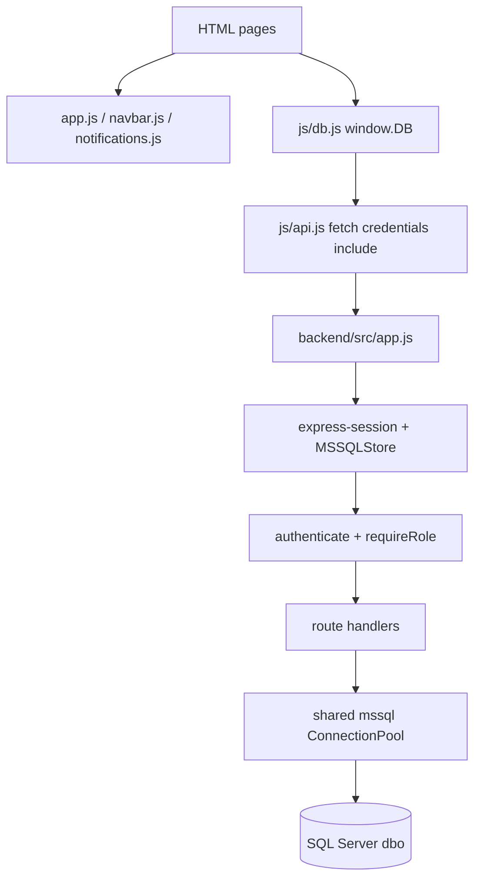

# Kiến trúc và luồng dữ liệu

## Phân lớp

Project dùng static frontend + Express API + SQL Server. Không tìm thấy controller/service/repository tách riêng; route handler truy vấn SQL trực tiếp qua shared pool. Frontend dùng adapter `js/db.js` để giữ API kiểu `window.DB`, HTTP client ở `js/api.js`, auth UI ở `js/auth.js`.



## Request và database

1. Browser gọi `apiRequest()`; URL lấy hostname hiện tại và port `3000`, request gửi `credentials: 'include'` (`js/api.js`).
2. `app.js` xử lý CORS allowlist, JSON body giới hạn 1 MB, session middleware và mount route.
3. Protected router chạy `authenticate`; user ID lấy từ `req.session.userId`, tra `dbo.users`, kiểm tra status active, gán `req.user`.
4. `requireRole(...)` kiểm tra `req.user.role`.
5. Handler dùng `getPool().request().input(...)` với SQL parameters; một số luồng dùng `sql.Transaction`.
6. `errorHandler` log chi tiết server-side; trả thông báo an toàn/SQL schema mismatch code 207/208 cho client.

Không có model/entity/repository, ORM, service layer, OpenAPI spec hay DI container được tìm thấy.

## Authentication/session

```mermaid
sequenceDiagram
  actor Browser
  participant Auth as auth.js / api.js
  participant API as Express
  participant SQL as SQL Server
  Browser->>Auth: POST /api/auth/register hoặc /login
  Auth->>API: JSON + credentials include
  API->>SQL: Tìm/tạo users; Argon2 verify/hash
  API->>API: regenerate session, gán userId, save
  API-->>Browser: user summary + HttpOnly cookie
  Browser->>API: API request kèm cookie
  API->>SQL: đọc session store, tra user/status
  API-->>Browser: response theo role/ownership
  Browser->>API: POST /api/auth/logout
  API->>SQL: destroy session
  API-->>Browser: xóa cookie
```

Frontend lưu `currentUser` trong localStorage để hiển thị UI và gọi `/api/me` bất đồng bộ khi vào trang. API vẫn xác thực lại session; local cache không phải credential tin cậy ở backend. Server dùng Argon2id, session regeneration, cookie HttpOnly, `secure` theo `NODE_ENV=production`, `sameSite=lax`, TTL 7 ngày.

## Phân quyền và ownership

- Role middleware kiểm tra role, nhưng ownership phải được kiểm tra thêm trong SQL (`recruiter_id`, `candidate_id`).
- Các luồng applications, jobs employer, company, invites, interviews thường có ownership predicate.
- `GET /api/users/:id` có route auth/role nhưng không áp dụng `search_status`; xem ISSUE-001.
- Endpoint public job/stats không có authenticate.

## Các luồng nghiệp vụ

### Ứng tuyển

```mermaid
sequenceDiagram
  actor Candidate
  participant Page as candidate/apply.html
  participant API as POST /api/applications
  participant DB as SQL Server
  Candidate->>Page: Gửi jobId + CV text
  Page->>API: JSON qua js/db.js
  API->>DB: Kiểm tra job active/chưa hết hạn
  API->>DB: INSERT application (parameterized)
  DB-->>API: ID; query lại application
  API-->>Page: 201 application hoặc lỗi 400/404/409
```

### Nhắn tin

`messages.routes.js` phân trang lịch sử theo cursor `beforeId` + `beforeTimestamp`, 50 bản ghi/lần. Gửi message là INSERT parameterized; đánh dấu đọc cập nhật các bản ghi incoming. Danh sách hội thoại hiện phải window/aggregate qua toàn bộ lịch sử message của user (rủi ro khi lịch sử lớn).

### Lịch phỏng vấn

Employer xác minh application thuộc job của mình trong transaction, upsert một interview/application, cập nhật status application. Constraint unique cho `application_id` chỉ được tạo khi bảng mới từ migration 004; bảng cũ chưa được migration xác thực đầy đủ.

### Lượt xem hồ sơ

Employer mở `employer/candidate-profile.html`; frontend gọi `POST /api/profile-views`; server kiểm tra ứng viên active, upsert theo ngày UTC. Candidate đọc bằng `GET /api/profile-views`; dashboard và trang lịch sử đọc cùng API.

## Navigation, lỗi, logging

- Điều hướng chính/sidebar được dựng bằng `js/navbar.js` và `js/app.js`.
- `asyncHandler` chuyển rejected Promise đến Express error middleware.
- JSON malformed trả 400; SQL lỗi schema 207/208 trả 503 với thông báo tổng quát; lỗi khác 500 tổng quát.
- Backend log error object và method/path. Không thấy logger có correlation ID, structured log config hoặc log rotation.
- Health `/api/health` chỉ xác nhận HTTP process; `/api/health/db` chạy `SELECT 1`.

## Tích hợp và file

- Firebase client imports và migration legacy đã được gỡ khỏi source; frontend hiện đi qua Express API. Network runtime chưa kiểm tra.
- Không tìm thấy email, file upload/download, object storage, WebSocket/SignalR.
- Không tìm thấy test/build/deployment pipeline.
