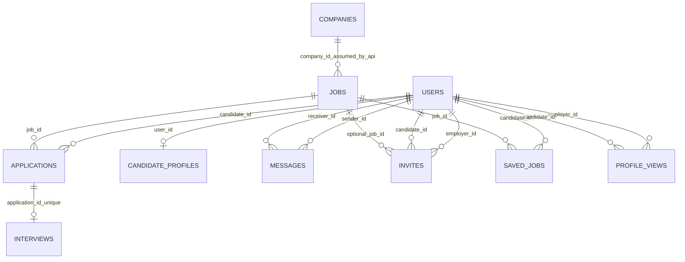

# SQL Server — tài liệu database

## A. Database và schema lifecycle

- Driver: `mssql` (Tedious transitively); schema mặc định dùng `dbo`.
- `backend/.env.example` khai báo `DB_SERVER`, `DB_PORT` hoặc `DB_INSTANCE`, `DB_NAME` (ví dụ `job_viet`), `DB_USER`, `DB_PASSWORD`, `DB_ENCRYPT`, `DB_TRUST_CERT`.
- `backend/src/config/database.js` tạo connection pool singleton: max 10, min 0, idle 30s, connection timeout 15s, request timeout 30s. SQL login được cấu hình; Windows integrated auth không được cấu hình trong code này.
- Schema được thay đổi thủ công qua SSMS bằng 11 script `backend/sql/001`–`011`. Không có migration runner, bảng lịch sử phiên bản, transaction chung, rollback script hoặc script tạo database lõi.
- Các scripts phụ thuộc các bảng có sẵn `dbo.users`, `dbo.jobs`, `dbo.companies`; không tìm thấy DDL gốc để tạo chúng. Vì thế không thể dựng database sạch chỉ từ repo.
- Runtime SQL Server không kết nối trong audit; các cột, kiểu, constraints, triggers và indexes thực tế chưa được truy vấn. Mô tả dưới đây là schema được khai báo trong source, không phải schema runtime xác nhận.

## B. Các bảng

### Bảng được tạo bởi scripts

| Bảng | Cột được khai báo | PK/FK/constraints/index | Chứng cứ và lưu ý |
|---|---|---|---|
| `dbo.sessions` | `sid NVARCHAR(255) NOT NULL`; `session NVARCHAR(MAX) NOT NULL`; `expires DATETIME NOT NULL` | PK sid; index `ix_sessions_expires`; không khai báo FK | `001_create_sessions.sql`. Dùng bởi `connect-mssql-v2`; session TTL 7 ngày đặt trong `config/session.js`. |
| `dbo.applications` | `id BIGINT IDENTITY`; `job_id BIGINT`; `candidate_id BIGINT`; `cv_text NVARCHAR(MAX)`; `status NVARCHAR(30)` default `applied`; `applied_at`, `updated_at DATETIME2(0)` UTC defaults | PK id; unique `(job_id,candidate_id)`; status CHECK; FK jobs/users; indexes candidate/applied_at và job/applied_at | `002_create_applications.sql`. `003` bổ sung `cv_text` nullable nếu bảng có sẵn thiếu cột; do đó schema mới và schema nâng cấp có thể khác nullability. |
| `dbo.interviews` | `id BIGINT IDENTITY`; `application_id BIGINT`; `interview_date DATE`; `interview_time TIME(0)`; `scheduled_at DATETIME2(0)`; `interview_type NVARCHAR(20)`; `notes NVARCHAR(2000)`; timestamps | PK; unique application_id; CHECK online/offline; FK application ON DELETE CASCADE | `004_create_interviews.sql`; `005` thêm cột thiếu nullable trừ timestamps, backfill common legacy columns. Cột nullable/runtime constraint có thể khác với bảng mới. |
| `dbo.candidate_profiles` | `user_id BIGINT`; `title NVARCHAR(200)`; `location NVARCHAR(200)`; `experience NVARCHAR(100)`; `skills NVARCHAR(MAX)` (JSON text trong API) | PK user_id; FK users ON DELETE CASCADE; không có index khác khai báo | `006_add_profile_fields.sql`. |
| `dbo.saved_jobs` | `candidate_id BIGINT`; `job_id BIGINT`; `saved_at DATETIME2(0)` UTC default | Composite PK `(candidate_id,job_id)`; FK users/jobs; index `(job_id,candidate_id)` | `007_create_saved_jobs.sql`. |
| `dbo.messages` | `id BIGINT IDENTITY`; sender/receiver BIGINT; `content NVARCHAR(MAX)` ban đầu, sau migration 009 tối đa `NVARCHAR(2000)`; `sent_at DATETIME2(0)`; `is_read BIT` default 0; `read_at DATETIME2(0)` nullable | PK; CHECK người gửi khác người nhận, nội dung trim không rỗng; FK sender/receiver users; index `(sender_id,receiver_id,sent_at,id)` và `(receiver_id,is_read,sender_id,sent_at,id)` | `008_create_messages.sql`, `009_limit_message_content.sql`. 009 từ chối thay đổi nếu có nội dung >2.000 ký tự (DATALENGTH > 4000), không tự truncate. |
| `dbo.invites` | `id BIGINT IDENTITY`; employer/candidate BIGINT; optional `job_id BIGINT`; `message NVARCHAR(1000)`; `status NVARCHAR(20)` default pending; `created_at`, `updated_at DATETIME2(0)` UTC defaults | PK; CHECK status pending/accepted/rejected; FK users/users/jobs; indexes candidate/status/created_at và employer/created_at | `010_create_invites.sql`. Không có unique constraint cho lời mời pending. |
| `dbo.profile_views` | `id BIGINT IDENTITY`; employer/candidate BIGINT; `viewed_on DATE`; `viewed_at DATETIME2(0)` | PK; CHECK employer != candidate; hai FK users; default viewed_on/viewed_at; index candidate/employer/day | `011_create_profile_views.sql`. Không có unique constraint theo employer/candidate/day; route dựa transaction lock. Migration đã được sửa để bổ sung `viewed_on` cho bảng tồn tại; DB runtime chưa được audit trực tiếp. |

### Bảng lõi được tham chiếu nhưng thiếu DDL

| Bảng | Cột được API/migration kỳ vọng | Không thể xác minh |
|---|---|---|
| `dbo.users` | id, email, password_hash, full_name, phone, role, status; migration 006 thêm search_status/two_factor_enabled | DDL gốc, nullability, defaults, unique email, role/status CHECK, indexes. |
| `dbo.companies` | id, employer_id, name, logo, industry, size, location, website, description | DDL gốc, unique employer_id, FK, nullability và indexes. |
| `dbo.jobs` | id, company_id, recruiter_id, title/description/requirements/benefits, category/location, salary_display/currency, job_type/experience, status/views, created_at/updated_at/expires_at | DDL gốc, constraints/status domain, FK/indexes, trigger và kiểu chính xác. Lỗi runtime trước đây của người dùng xác nhận có trigger bật trên dbo.jobs; trigger source/định nghĩa không nằm trong repo. |

## C. ERD (quan hệ được xác nhận trong migration/code)

Các entity `users/jobs/companies` và các cột nối của chúng là giả định API đang dùng, DDL lõi chưa tìm thấy.

## D. Truy vấn và nghiệp vụ

- Queries dùng parameters của `mssql` cho input. Một số identifier/column fragments trong `UPDATE` được dựng từ whitelist hằng trong route (`employer-jobs.routes.js`, `employer-company.routes.js`, `me.routes.js`).
- Application insert xử lý duplicate qua SQL unique violation 2601/2627; interview upsert dùng transaction; saved-job/profile-view dùng lock hints; job view dùng `UPDATE ... OUTPUT ... INTO` do trigger compatibility.
- Tin nhắn trang lịch sử có cursor và `TOP 51` để trả tối đa 50. Các list jobs/applications/interviews/invites/saved jobs/profile views/candidates và conversations chưa có giới hạn API.
- `GET /messages/conversations` dùng CTE/window `ROW_NUMBER` và `SUM` trên toàn bộ messages user để tìm latest/unread; có thể đọc nhiều lịch sử khi số tin lớn.
- Không thấy stored procedure, view hay trigger được tạo trong repo. Trigger runtime trên `dbo.jobs` được chứng minh bởi log người dùng trước đó; trạng thái các trigger khác chưa biết.

## E. Chất lượng, hiệu năng và toàn vẹn

1. **Schema gốc thiếu:** migrations 002/006/007/008/010/011 phụ thuộc các bảng users/jobs/companies. Cần bổ sung baseline có kiểm soát, không tự chạy script trên DB hiện tại khi chưa đối chiếu metadata.
2. **Migrations không phải migration framework:** phần lớn chỉ tạo nếu chưa có bảng; khi bảng đã tồn tại script in “đã tồn tại” và bỏ qua kiểm tra cấu trúc. `005`/`006`/`008`/`011` có upgrade logic từng cột, nhưng không có version ledger/rollback.
3. **Pagination:** nhiều endpoints list trả toàn bộ rows. Với lớn số lượng tin/đơn/ứng viên/lời mời, RAM và thời gian response tăng.
4. **Conversation aggregate:** cần đo execution plan/thống kê trên DB thực tế trước khi thêm index hay thay query. Chưa đủ căn cứ đề xuất index khác ngoài đánh giá bằng actual execution plan.
5. **Concurrency duplicate invite:** SELECT rồi INSERT không đủ chống hai request đua; migration không unique pending constraint. Xác định thiết kế constraint/filtering phù hợp với nullable job trước khi triển khai.
6. **Constraints tùy schema lịch sử:** `003` thêm cv nullable, `005` cột interview có thể nullable, trong khi route logic giả định field có giá trị; đối chiếu và backfill bằng migration versioned.
7. **Lưu message:** `content` được giới hạn 2.000 ký tự, không có file attachment. SQL Server vẫn lưu mọi message trong bảng; code hiện chưa có archive/retention job.
8. **Ảnh hưởng xóa:** chỉ FK interviews→applications và candidate_profiles→users khai báo cascade trong scripts. Các hành vi xóa base entities/runtime cascade chưa xác minh.
9. **Không kết luận injection:** không thấy user value được nội suy trực tiếp vào SQL; vẫn cần regression review mọi dynamic query mới.

## Cách xác minh runtime sau này

Audit này không chạy truy vấn metadata. Trước thay đổi schema, xuất metadata an toàn từ SSMS (sys.tables/sys.columns/sys.foreign_keys/sys.indexes/triggers), đối chiếu với từng handler. Không đưa dữ liệu người dùng hoặc secret vào tài liệu. Không chạy migration trong khuôn khổ audit này.
