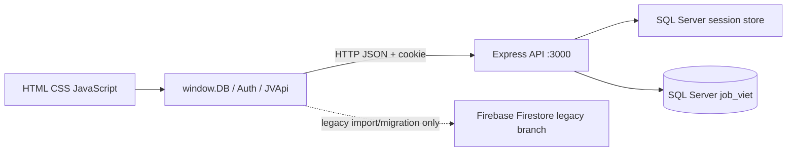

# JobViệt — Tổng quan kiểm toán project

## Mục đích

JobViệt là ứng dụng tuyển dụng: ứng viên tìm và ứng tuyển việc làm; nhà tuyển dụng đăng tin, quản lý ứng viên, phỏng vấn và trao đổi tin nhắn. Đây là kết luận dựa trên các trang HTML, lớp dữ liệu frontend và các route API hiện có.

## Người dùng và vai trò

| Vai trò | Bằng chứng trong code | Quyền chính |
|---|---|---|
| Khách chưa đăng nhập | Trang công khai, `backend/src/routes/jobs.routes.js` | Xem danh sách/chi tiết việc làm, thống kê; gọi ghi lượt xem job. |
| `candidate` | `requireRole`, các trang `candidate/` | Ứng tuyển, lưu việc, quản lý hồ sơ, phỏng vấn, tin nhắn, lời mời và lượt xem hồ sơ. |
| `employer` | `requireRole`, các trang `employer/` | Đăng tin, quản lý công ty/đơn ứng tuyển, lên lịch phỏng vấn, nhắn tin, mời ứng viên. |
| `admin` | Một số route cho phép role `admin` | Một số thao tác ứng tuyển/xem ứng viên; không tìm thấy luồng tạo tài khoản admin hoặc giao diện quản trị hoàn chỉnh trong source đang có. |

## Chức năng chính đã tìm thấy

- Trang giới thiệu, liên hệ, trang chủ, tìm kiếm và xem chi tiết việc làm.
- Đăng ký/đăng nhập SQL Server, cookie session, đăng xuất và `/api/me`.
- Hồ sơ ứng viên/công ty; đăng, sửa, đóng tin tuyển dụng.
- Ứng tuyển, theo dõi/cập nhật trạng thái, lịch phỏng vấn.
- Việc đã lưu, tin nhắn phân trang theo cuộc trò chuyện, lời mời kết nối, lượt xem hồ sơ.
- Thống kê tổng quan và lượt xem job.

Có code không đồng nghĩa đã được xác minh chạy. Ma trận chi tiết ở [FEATURES.md](FEATURES.md); API ở [API_DOCUMENTATION.md](API_DOCUMENTATION.md).

## Công nghệ và kiến trúc

- Frontend: HTML/CSS/JavaScript ES modules thuần; không có framework hoặc build tool khai báo.
- Backend: Node.js + Express, CommonJS, `mssql` kết nối SQL Server, `express-session` và `connect-mssql-v2` lưu session, Argon2 băm mật khẩu.
- Database: SQL Server, schema `dbo`; cấu hình ví dụ đặt `DB_NAME=job_viet`.
- Tích hợp còn trong client: Firebase Auth/Firestore SDK được import từ CDN ở `js/firebase-config.js` và `js/db.js`, bao gồm nhánh tự migrate dữ liệu localStorage lên Firestore.
- Không tìm thấy dịch vụ gửi email, upload file, WebSocket/SignalR, Redis, ORM, OpenAPI/Swagger hoặc pipeline deploy.

## Cấu trúc project con

- Frontend nằm ở root, `candidate/`, `employer/`, `css/`, `js/` và `ico/`.
- Backend độc lập ở `backend/`, có `package.json`, `package-lock.json`, source Express và các SQL migration đánh số `001`–`011`.
- Không tìm thấy README, test suite, migration runner, base schema SQL cho `users`, `companies`, `jobs`, hoặc package/build config ở root.

## Điều kiện chạy (theo cấu hình)

- Node.js và npm; tại lần audit, runtime là Node `v24.19.0`, npm `11.17.0`.
- SQL Server với database/schema phù hợp và tài khoản SQL; biến môi trường cần thiết được liệt kê trong `backend/.env.example` (không ghi giá trị bí mật trong tài liệu).
- Chạy backend từ `backend/`; frontend cần được phục vụ bằng web server tĩnh tại origin nằm trong `FRONTEND_ORIGINS` và cùng hostname với API để cookie hoạt động.
- Chưa xác minh kết nối database hoặc chạy ứng dụng trong lần audit.

## Tài liệu audit

- [Công nghệ và dependency](TECH_STACK.md)
- [Cây thư mục](DIRECTORY_STRUCTURE.md)
- [Danh sách chức năng](FEATURES.md)
- [Kiến trúc và luồng dữ liệu](ARCHITECTURE.md)
- [Tài liệu API](API_DOCUMENTATION.md)
- [Database SQL Server](DATABASE.md)
- [Lỗi và vấn đề](BUGS_AND_ISSUES.md)
- [Kiểm tra bảo mật](SECURITY_AUDIT.md)
- [Chạy và triển khai](RUN_AND_DEPLOY.md)
- [Tình trạng kiểm thử](TESTING.md)
- [Lộ trình cải thiện](IMPROVEMENT_ROADMAP.md)

## Giới hạn và trạng thái xác minh

- Tài liệu mô tả source code trong working tree tại ngày 2026-10-22; working tree có thay đổi chưa commit trước audit.
- Chỉ kiểm tra cú pháp JavaScript và dependency backend; không có bài test tự động.
- Không đọc file `backend/.env`, không kết nối SQL Server, không chạy migration và không đọc dữ liệu runtime.
- Các bảng `dbo.users`, `dbo.companies`, `dbo.jobs` được API và migrations tham chiếu nhưng không có DDL tạo ban đầu trong project. Schema runtime vì vậy chưa thể đối chiếu đầy đủ.
- Trước đó người dùng đã báo thành công một số luồng trong trao đổi, nhưng không có log/checklist đầy đủ để coi là kiểm thử độc lập cho toàn ứng dụng.
- Có 562 mục Git thay đổi nhìn thấy khi audit (515 deletions, 43 modifications, 4 untracked). Trong đó có nhiều file dưới `LabThucHanh/` đang bị đánh dấu xóa; không quy nguyên nhân và không thay đổi chúng.
